## Application/platform-level CVD themes

Whole products shipping first-party colorblind themes (not editor plugins — the app itself).
Verified via merged PRs and source files:

| Product | What shipped | Merge | CVD types | Dark/Light | Source |
|---|---|---|---|---|---|
| **Grafana** | four UI themes (Deuteranopia/Protanopia + Tritanopia, dark+light) **and** a colorblind-safe viz palette option | [PR #116953](https://github.com/grafana/grafana/pull/116953) (2026-03), [PR #121385](https://github.com/grafana/grafana/pull/121385) (2026-04) | protan/deutan + tritan | both | [themeDefinitions](https://github.com/grafana/grafana/tree/main/packages/grafana-data/src/themes/themeDefinitions) |
| **coder/coder** | four sitewide colorblind theme palettes; source **cites Okabe-Ito** and maps destructive→vermilion/orange, success→sky-blue, warning→fuchsia | [PR #24672](https://github.com/coder/coder/pull/24672) (2026-05) | protan/deutan + tritan | both | [site/src/theme](https://github.com/coder/coder/tree/main/site/src/theme) |
| **Kilo Code CLI** | `/colorblind` toggle theme with high-contrast colors + patterns | [PR #4936](https://github.com/Kilo-Org/kilocode/pull/4936) (2026-01) | general | dark | repo |
| **Daintree IDE** | "Color vision" appearance mode overriding ~10 semantic tokens (status, github open/closed, terminal ANSI red/green) with live swatch preview | [PR #3042](https://github.com/daintreehq/daintree/pull/3042) (2026-03) | deuteran/protan + tritan | both | repo |

**Grafana** is the flagship here — the first major observability platform with built-in CVD themes.
The four theme files (`deuteranopia_protanopia_{dark,light}.json`, `tritanopia_{dark,light}.json`)
override the semantic signal colors: dark success `#2EC4B6` (teal) / error `#FF7A18` (orange) /
warning `#FFF899`; light success `#006F7A` / error `#FF9900` / warning `#FFEE52`. The viz palette
([`fieldColor.ts`](https://github.com/grafana/grafana/blob/main/packages/grafana-data/src/field/fieldColor.ts),
`PaletteColorblind` mode) is **Wong (2011) / Okabe–Ito verbatim** with black/white for
theme-adaptive contrast — the source comment cites Wong directly and states all 8 colors are
validated as mutually distinguishable under all three dichromacies.

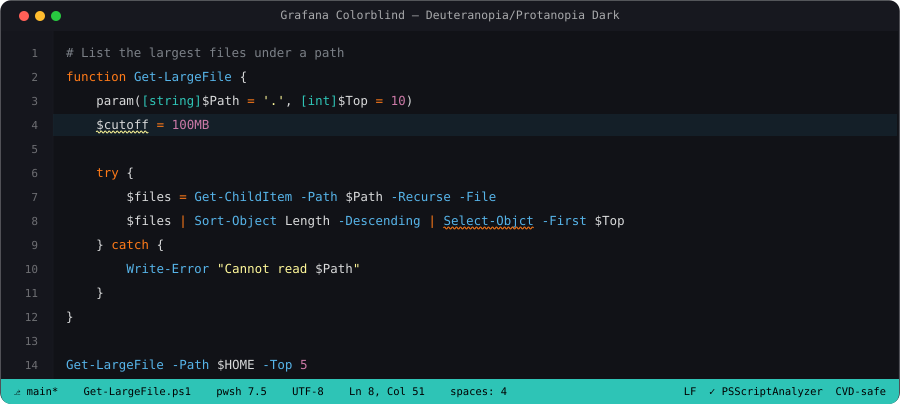

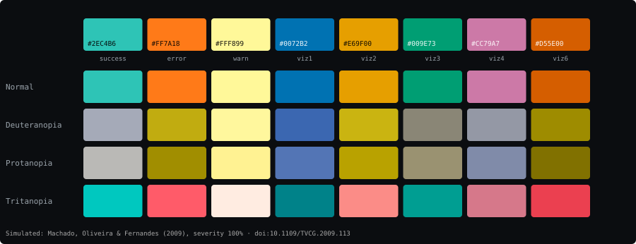

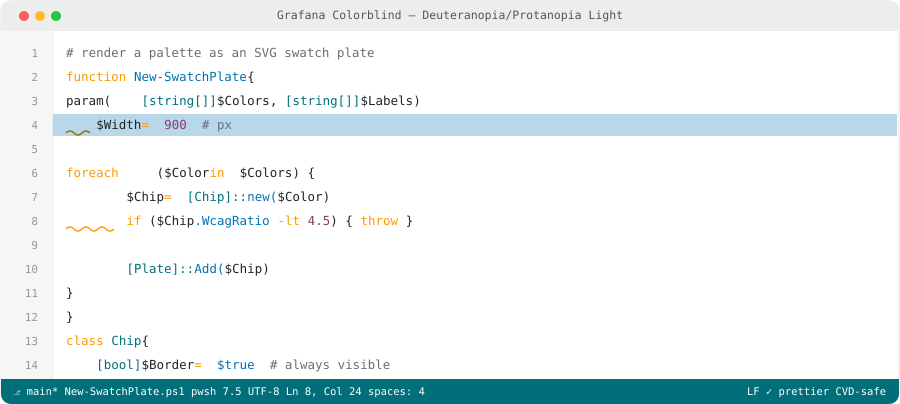

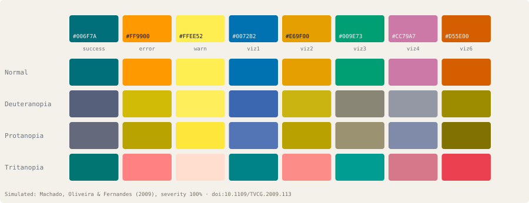

**coder/coder**'s `darkProtanDeuter/roles.ts` is unusually well-documented: *"Protanopia and
deuteranopia compress the red/green channel, so semantic good/bad pairs that rely on green vs red
need a different axis. We shift destructive states onto a vermilion/orange hue (Tailwind orange
scale, inspired by the Okabe-Ito CVD-safe scheme), positive/active states onto sky-blue, and warning
onto fuchsia so it does not collide with destructive states on the orange axis."*

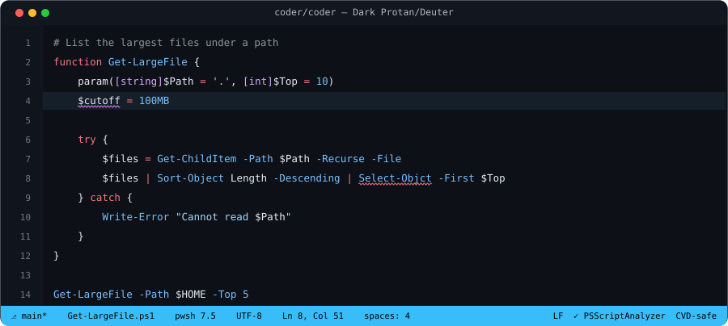

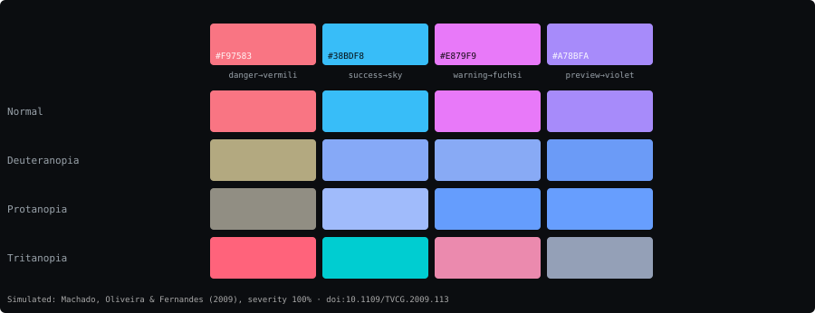

## 20 more application-level CVD themes (merged, primary-source verified)

A GitHub merged-PR sweep across observability, code hosts, git GUIs, chat, note apps, CAD/3D
printing, game clients, and mobile surfaced these (full extraction notes in `.research/09-app-level.md`):

| Product | What shipped | Merge | Hexes / approach | Link |
|---|---|---|---|---|
| **Gitea** (→ Forgejo) | six first-party CSS variants: protan/deutan + tritan, dark/light/auto; diff red/green → blue/orange | 2024-04 [PR #30625](https://github.com/go-gitea/gitea/pull/30625) | dark add `#58a6ff`/del `#f0883e`, light add `#0860cc`/del `#a84400` | [themes](https://github.com/go-gitea/gitea/tree/main/web_src/css/themes) |
| **SimpleCov** | Colorblind toggle in the HTML coverage report (every Ruby project) | 2026-08 [PR #1257](https://github.com/simplecov-ruby/simplecov/pull/1257) | covered/missed: green/red → blue/orange, light+dark | repo |
| **plannotator** | full colorblind theme (dark+light), Machado-verified CIEDE2000 ≥ 8.9 | 2026-08 [PR #1192](https://github.com/backnotprop/plannotator/pull/1192) | add `#4f83d1`/del `#c96e12` (dark) | repo |
| **GitButler** | colorblind diff preview composing with 3 contrast levels × light/dark (12 palettes) | 2025-09 [PR #10146](https://github.com/gitbutlerapp/gitbutler/pull/10146) | blue/orange diff, full matrix | repo |
| **iamb** (Matrix TUI) | `okabe-ito-dark` theme; encrypted indicator deliberately **blue, not green** | 2026-10 [PR #822](https://github.com/ulyssa/iamb/pull/822) | full Okabe-Ito | repo |
| **tuicr** | `github-dark-colorblind` theme for the code-review TUI | 2026-08 [PR #523](https://github.com/agavra/tuicr/pull/523) | add `#58a6ff`/del `#f0883e` | repo |
| **Ultimaker Cura** | Colorblind Assist themes (dark+light) for layer-view line types — **oldest first-party entry (2019)** | 2019-07 [PR #5928](https://github.com/Ultimaker/Cura/pull/5928) | teal/yellow/cyan/blue layer colors | repo |
| **OpenFront.io** | Colorblind graphics preset; **largest published CVD hex pool (96)** | 2026-06 [PR #4150](https://github.com/openfrontio/OpenFrontIO/pull/4150) | Okabe-Ito team colors verbatim | repo |
| **RuneLite** | GPU-plugin colorblindness correction — **GLSL daltonization shader**, not a palette (unique mechanism) | 2020-11 [PR #12744](https://github.com/runelite/runelite/pull/12744) | per-deficiency LMS matrices (no hexes by design) | repo |
| **Talishar-FE** | **three distinct palettes, one per dichromacy** (rare) | live `colorblindPresets.ts` | deutan `#33aaee…`, protan `#11bbff…`, tritan `#22eeff…` | repo |
| **deepinv** (PyTorch imaging) | colorblind matplotlib cycle + marker cycler (redundant encoding) | 2026-09 [PR #1420](https://github.com/deepinv/deepinv/pull/1420) | Seaborn colorblind verbatim | repo |
| **gEAR** (genomics) | comprehensive colorblind mode across all plot types | 2026-10 [PR #1341](https://github.com/IGS/gEAR/pull/1341) | cividis + colorcet glasbey_cool | repo |
| **portico** (Filament admin) | per-user Okabe-Ito toggle (`colorblind_palette` column) | 2026-10 [PR #192](https://github.com/AsteriaCreations/portico/pull/192) | success `#0072B2`, danger `#D55E00`, warning `#E69F00` | repo |
| **steady** | five vision modes with measured ΔE00 floors | 2026-10 [PR #4](https://github.com/GabrielAboyDev/steady/pull/4) | quantified protan/deutan spacing | repo |
| **nammet-recipe-website** | "Blue & orange" + "Teal & crimson" themes; Machado test in CI (ΔE ≥ 40) | 2026-10 [PR #12](https://github.com/foshiee/nammet-recipe-website/pull/12) | simulation-gated | repo |
| **OSC_Workout_App** | light/dark/colorblind three-theme toggle | 2026-10 [PR #55](https://github.com/ufosc/OSC_Workout_App/pull/55) | Okabe-Ito `#56b4e9/#e69f00/#f0e442` | repo |
| **mai-tutor** | "Dark (colorblind-friendly)" mode | 2026-10 [PR #49](https://github.com/nguyen18/mai-tutor/pull/49) | Okabe-Ito-derived | repo |
| **cloudping.co** | latency colors recolored CVD-safe **by default for everyone** | 2026-10 [PR #100](https://github.com/mda590/cloudping.co/pull/100) | `#38bdf8/#facc15/#dc2626` | repo |
| **paseo** | colorblind mode: status green/red differ in **lightness** not just hue | 2026-09 [PR #5](https://github.com/ChrisjanWust/paseo/pull/5) | WCAG 1.4.1 luminance strategy | repo |
| **kitty** (`deuters_delight`) | curated first-party terminal theme replacing three older CVD attempts | 2022-04 [PR #44](https://github.com/kovidgoyal/kitty-themes/pull/44) | per-deficiency named | repo |

**Three patterns across all app-level CVD themes:**

1. **Okabe-Ito anchoring is dominant** — iamb, portico, OpenFront, OSC_Workout, deepinv, mai-tutor,
   RustySNES all cite or embed the eight canonical hexes. It is the de-facto standard.
2. **Blue/orange is the universal diff/status swap** — Gitea, SimpleCov, GitButler, plannotator,
   tuicr all converge on GitHub's `#58a6ff`/`#f0883e` (dark) or Okabe-Ito's `#0072B2`/`#D55E00`.
3. **Per-deficiency variants are emerging as the highest-fidelity approach** — Grafana (4 themes),
   Talishar (3 palettes), Gitea (2 CSS families), steady (5 modes) ship distinct palettes per CVD
   type rather than one "universal" palette, matching modus/ef-themes in editor space.

**Verified negatives** (no first-party CVD theme as of 2026-11-05): DataDog, Prometheus, Kibana,
GitLab (first-party — the third-party `gitlab-colorblind` extension covers it), Bitbucket, Linear,
Asana, Monday, Jira, Slack/Discord/Teams/Element/Zulip, Obsidian/Logseq/Joplin (first-party), Godot,
Unity, Bitwarden, Anki, Home Assistant, Jellyfin, FreeCAD, KiCad, ArgoCD, k9s, Swagger UI.

## First-party product themes (Wireshark, Insomnia, and more)

Including the oldest app-level CVD theme found anywhere (Jenkins, 2012).

**Wireshark** ships **Protanopia & Deuteranopia** and **Tritan** themes (dark + light) — Okabe-Ito/Wong
verbatim, gated by `test/suite_theme.py` which checks every token stays distinguishable under each
listed deficiency. The first major network-analysis tool with first-party CVD themes.
([themes dir](https://github.com/wireshark/wireshark/tree/main/resources/themes), GPL-2.0)

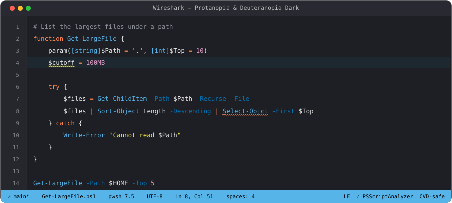

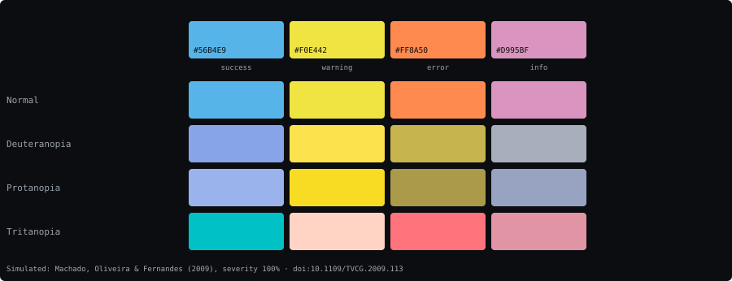

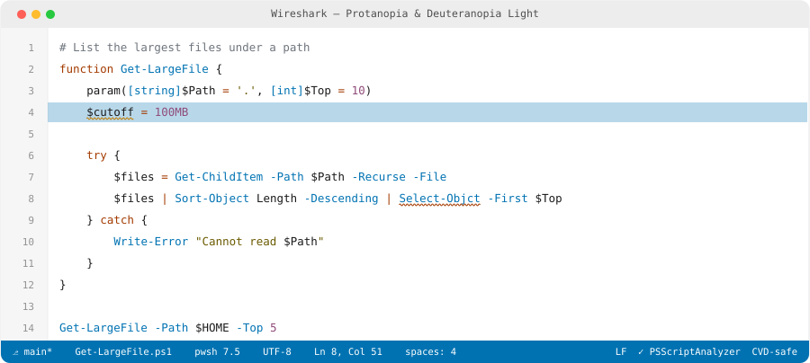

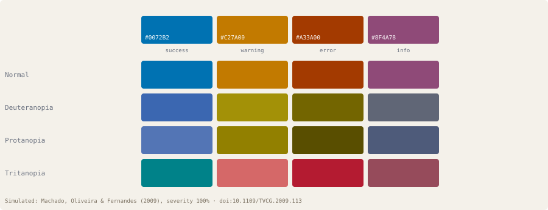

**Insomnia** (Kong) shipped a **Dark Colorblind core theme** in 2021 ([PR #4081](https://github.com/Kong/insomnia/pull/4081)) —
days after GitHub's own colorblind beta, and the only API client with a first-party CVD theme.
HTTP-method colors swap to blue/orange: POST/200 `#0080FF`, DELETE `#CC5500` (burnt orange).

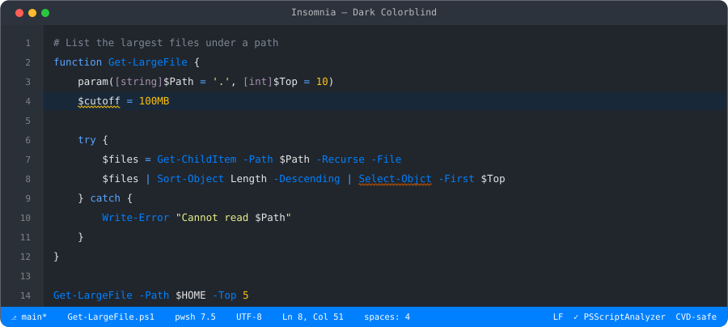

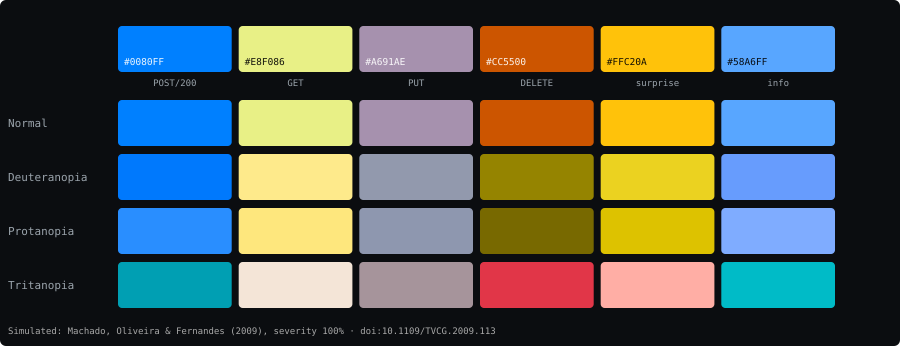

**Kiro** ships a built-in "Color-blind safe" theme pair (dark+light) with a simulation test that
measures every status pair under all three dichromacies; Okabe-Ito status hues.
([PR #24480](https://github.com/kirodotdev/KiroCrew/pull/24480))

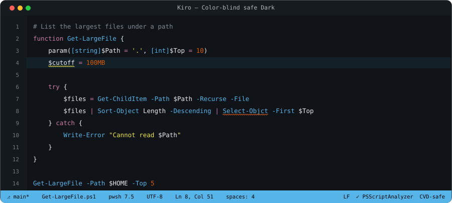

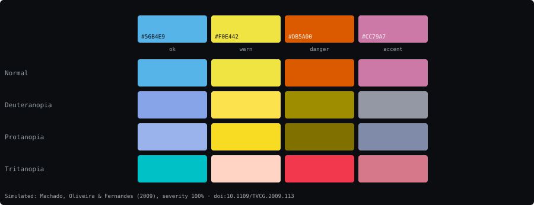

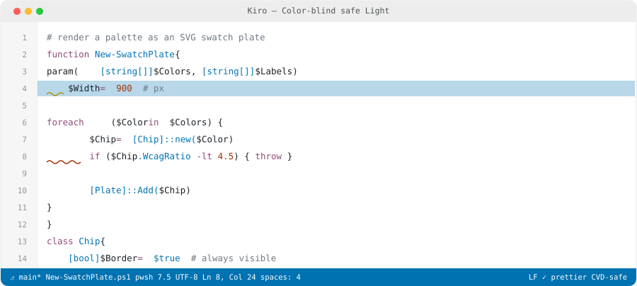

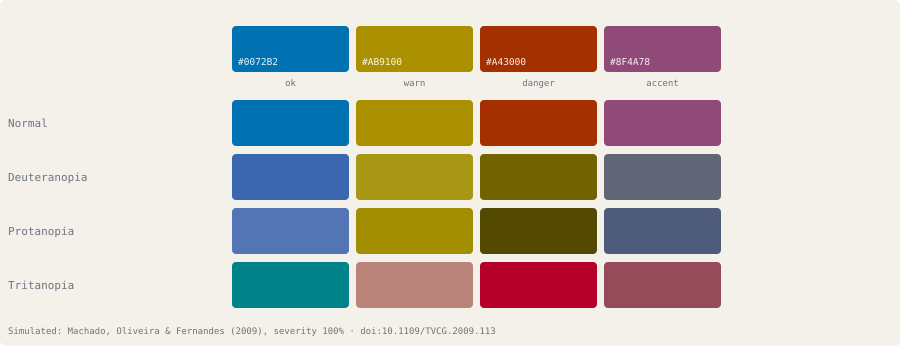

**Google's gemini-cli** ships `github-dark-colorblind` / `github-light-colorblind` built-ins — Primer
colorblind tokens verbatim in a Google first-party CLI.
([PR #15504](https://github.com/google-gemini/gemini-cli/pull/15504), Apache-2.0)

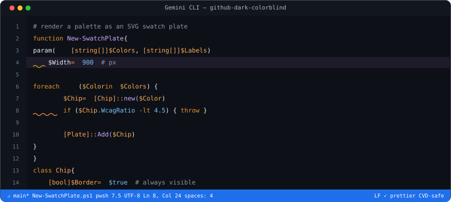

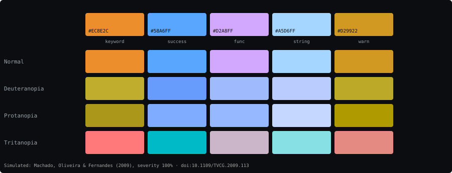

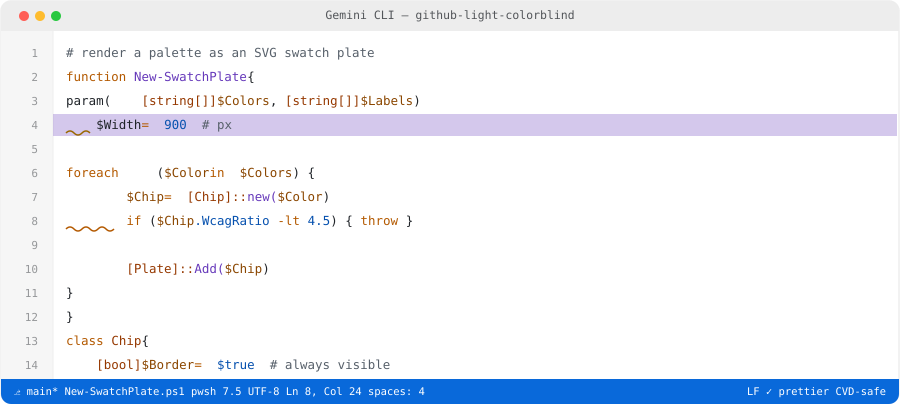

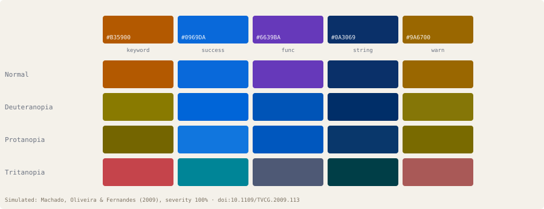

More product themes:

| Product | What shipped | Merge | Notes | Link |
|---|---|---|---|---|
| **Combodo iTop** | Fullmoon Protanopia/Deuteranopia + Tritanopia backoffice themes (first ITSM/CMDB) | 2024-04 [PR #639](https://github.com/Combodo/iTop/pull/639) | danger→orange, success→blue semantic remap | [repo](https://github.com/Combodo/iTop) |
| **narmi/design_system** | `cvd-red-green` + `cvd-tritanopia` token modes — **first banking design system** | 2026-08 [PR #2246](https://github.com/narmi/design_system/pull/2246) | design-token-level CVD modes | [repo](https://github.com/narmi/design_system) |
| **AREDN** firmware | color-blind CSS theme for mesh-radio UI (first embedded/network) | 2024-08 [PR #1418](https://github.com/aredn/aredn/pull/1418) | positive/negative → blue `#3994fd`/amber `#bb8b00` | [repo](https://github.com/aredn/aredn) |
| **Moira** alerting | ColorBlind theme toggle + icon redundancy | 2026-06 [PR #668](https://github.com/moira-alert/web2.0/pull/668) | OK `#00771e`, ERROR `#ff5722`, hue+icon | [repo](https://github.com/moira-alert/web2.0) |
| **Jenkins Wall Display** | `.colorblind` theme — **oldest app-level CVD theme found (2012)** | 2012-02 [PR #3](https://github.com/jenkinsci/walldisplay-plugin/pull/3) | blue `#BFD4FF` / red `#FF9180` / yellow `#FFF780` on white | [repo](https://github.com/jenkinsci/walldisplay-plugin) |
| **Warp** | Zenburn Colorblind (+ High Contrast) — closes the Warp gap | 2026-05 [PR #151](https://github.com/warpdotdev/themes/pull/151) | red `#ff7070`, blue `#70b3ff` | [repo](https://github.com/warpdotdev/themes) |
| **novelWriter** | `today_deuteranopia` + `today_tritanopia` — **uses simulated hues as the theme** | 2026-03 [PR #2694](https://github.com/saga-soft/novelWriter/pull/2694) | red→`#757500` (its deutan-simulated value) | [repo](https://github.com/saga-soft/novelWriter) |
| **Blockly / code.org** | `theme-deuteranopia` + `theme-tritanopia` block themes (2019; code.org trio 2023) — education | 2019-10 [PR #3322](https://github.com/RaspberryPiFoundation/blockly/pull/3322) | world's most-deployed educational block editor | [repo](https://github.com/RaspberryPiFoundation/blockly) |
| **accessible-pygments** | `github_dark/light_colorblind` + `blinds_dark/light` Pygments styles — fills the **doc-site highlighting** layer (Sphinx/Jupyter/MkDocs) | active 2026 | Quansight, BSD-3 | [repo](https://github.com/Quansight-Labs/accessible-pygments) |
| **Actual Budget** | "Color-blind (Dark)" Okabe-Ito theme in the official catalog — **first personal-finance app** | 2026-01 [PR #6696](https://github.com/actualbudget/actual/pull/6696) | Okabe-Ito verbatim | [repo](https://github.com/actualbudget/actual) |
| **GitKraken (kepler)** | "Blue Is the New Green" first-party theme; success→blue, danger→vermilion | 2026-10 [PR #8](https://github.com/gitkraken/kepler-themes/pull/8) | OKLCH tokens, statuses differ in lightness too | [repo](https://github.com/gitkraken/kepler-themes) |
| **heatherfield.nvim** | lightness-separated Neovim theme, no red/green pair | 2025 | blue/pink-heavy | [repo](https://github.com/egerhether/heatherfield.nvim) |
| **Oritone** | Okabe-Ito-derived multi-target theme + 6 scientific colormaps (Helix/Ghostty/Claude Code/Codex) | 2026 | dark+light | [repo](https://github.com/schmaeke/oritone) |
| **icingaweb2-theme-colourblind** | Icinga Web 2 monitoring theme — oldest monitoring entry (2017) | 2017 | deuteran/protan/tritan | [repo](https://github.com/sol1/icingaweb2-theme-colourblind) |
| **github-colorblind-theme** | Stylus/userstyle for github.com (Tol/IBM palette) — **userstyles category filled** | 2020 | `#648FFF #785EF0 #DC267F…` | [repo](https://github.com/nataquinones/github-colorblind-theme) |
| **Blender (GitHub port)** | GitHub Dark Colorblind ported to Blender 4 — creative-app category's lone entry | 2025 | Primer tokens in Blender XML | [repo](https://github.com/treviasxk/BlenderThemeGithub) |
| **MeshMonitor** | Color-blind-friendly themes split **per red / green / blue color blindness** (protan/deutan/tritan) in the built-in gallery — a Meshtastic mesh-network monitor | active 2026 | themes are user/DB-defined (screenshots confirm); palette not in static source | [gallery](https://meshmonitor.org/THEME_GALLERY.html) · [repo](https://github.com/Yeraze/meshmonitor) |
| **godhuli-theme** (VS Code) | CVD-**tested** theme — changelog: functions/methods/built-ins separated by lightness because they were "indistinguishable under CVD simulation" | active 2026 | CVD-tested, not CVD-designed; lightness-channel approach | [marketplace](https://marketplace.visualstudio.com/items?itemName=NotifyX.godhuli-theme) |

**Verified empty surfaces** (checked and confirmed to have no CVD theme): spicetify/Spotify,
btop/htop/glances, waybar/polybar/i3/sway, database GUIs (pgAdmin/DBeaver/phpMyAdmin), Postman/
Hoppscotch/Bruno, e-readers (Zathura/KOReader/calibre/Sumatra), email clients (Thunderbird/Mutt),
TradingView/finance terminals, Android launchers, GIMP/Krita/darktable. The Wordle-clone long tail
(dozens of near-identical student clones) is excluded as noise.

## Pitaya Smoothie — the only CVD-designed JupyterLab theme

Tania Allard / Quansight Labs
([jupyterlab-accessible-themes](https://github.com/Quansight-Labs/jupyterlab-accessible-themes),
upstream [trallard/pitaya_smoothie](https://github.com/trallard/pitaya_smoothie), BSD-3). "The
colour choices… were made taking into consideration accessibility for those with colourblindness —
by default the theme is suitable for multiple types of colourblindness, no settings tweaking
required." The README embeds protanopia/deuteranopia/tritanopia simulations and a WCAG AAA contrast
grid. Teal/pink axis with yellow warnings: brand teal `#1abec2`, accent pink `#f25a92`, warn
yellow `#fad000`, periwinkle `#7998f2`, lilac `#a56cf5`, orange `#f38672`, bg indigo `#181036`.
Dark only; uses the Atkinson Hyperlegible font.

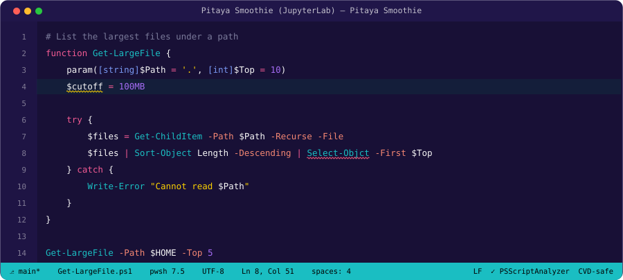

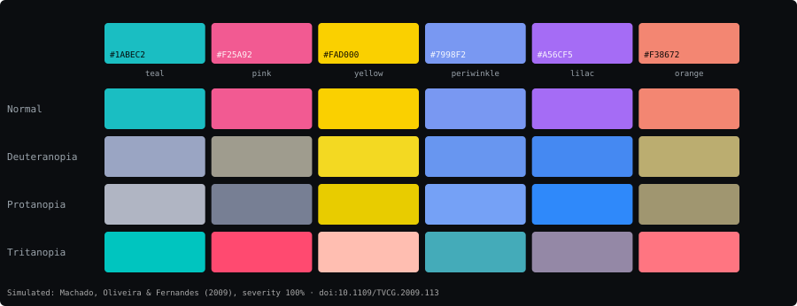

(Also in the Jupyter ecosystem: [`jupyterlab_colorblind`](https://github.com/mattwigway/jupyterlab_colorblind)
is a Machado-2009 **simulator** extension for previewing your own plots under CVD — tooling, not a theme.)

## Lx Deep Sea — a KDE Plasma color scheme for red-green CVD

lx21, 2022 ([store.kde.org/p/1711107](https://store.kde.org/p/1711107), GPLv3). The only CVD-labelled
Plasma color scheme found; the store front is bot-walled but the raw `.colors` file was fetched via
the OCS API. Author's claim: "high contrasts and at the same time eyefriendly and suitable for
red-green colorblindness." Dark; blue-tinted neutrals, blue links `#508ED8`, neutral `#55AAFF`.

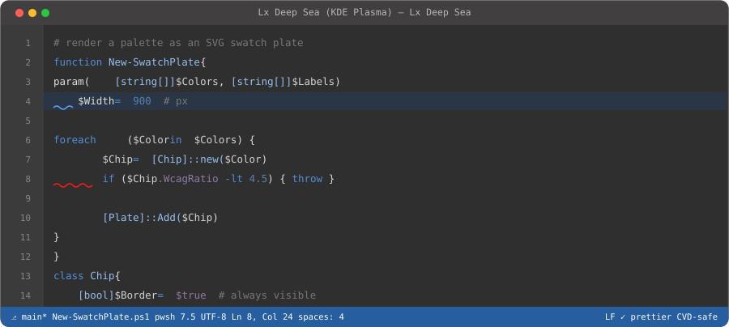

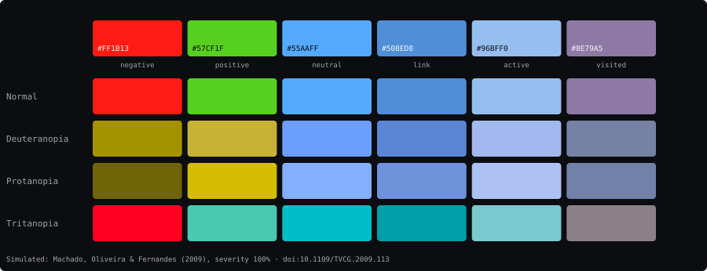

Honest caveat: its Negative `#FF1B13` (pure red) vs Positive `#57CF1F` (green) still differ mainly
by hue — the simulation strip shows them collapsing toward each other under deuteranopia/protanopia.
It leans on brightness/saturation separation rather than the orange↔blue hue remap the stronger
entries use. Included as the sole KDE desktop entry, with that limitation noted.

## Slack, Discord, Teams

- **Slack:** Opo ships the only published Slack CVD palette — a custom-theme import string
  (`#fbf8f2, #005ccc, #002c85, #a75000…`) built from its build-time-CVD-checked blue/orange axis
  ([`dist/slack/opo-light.txt`](https://github.com/IschaGast/opo-theme)). Slack's own "accessible
  theme" still publishes no hexes.
- **Discord:** [dalton-discord](https://github.com/lissarubi/dalton-discord) (MIT) claims Deutan
  intent with a blue `#2b7df0` accent — but its presence dots keep hard `#00FF00`/`#FF0000`, the
  canonical deutan confusion pair. Medium evidence; self-defeating status colors.
- **Teams:** genuine negative — no user theme format with published palettes; only an unpublished
  "high contrast" mode.

## The OS-level reality: filters, not themes

**No operating system ships a built-in CVD color scheme.** KDE (Breeze ships Classic/Dark/Light
only), GNOME (Adwaita + high-contrast only), and Windows (four high-contrast presets) all rely on
screen-level **daltonization/color-correction filters** instead:

- **KDE Plasma 6** — KWin "Color Blindness Correction" compositor effect (protan/deutan/tritan +
  monochrome), a real-time LMS-space daltonization shader applied to *everything* on screen.
  [docs](https://docs.kde.org/stable_kf6/en/plasma-desktop/kcontrol/kcmaccess/index.html) ·
  [source](https://github.com/KDE/kwin/tree/master/src/plugins/colorblindnesscorrection)
- **GNOME** — third-party "Colorblind Filters" shell extension (screen shader).
- **Windows 10/11** — Color Filters (protanopia/deuteranopia/tritanopia correction).
- **macOS/iOS** — Color Filters in Accessibility settings.

These correct the whole display rather than re-theming any app, which is why per-app CVD themes
(everything above) remain necessary: a global filter can't fix a palette that was never designed
to survive it, and it shifts *all* colors including the ones already safe.

---
