## vim-dichromatic (Vim/Neovim)

Romain Lafourcade, 2016 — "A dark Vim colorscheme for color blind vimmers. But not only."
([repo](https://github.com/romainl/vim-dichromatic), MIT). Built directly on **Paul Tol's SRON
colorblind-safe palette**, adapted to xterm-256. Dark only. bg `#080808`, fg `#D0D0D0`;
Number `#D75F87`, Statement `#AF5FAF`, String `#AFAF00`, Type `#87D7D7`, Title `#5FAF87`.

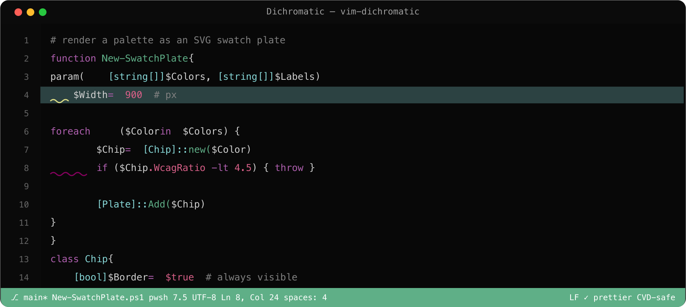

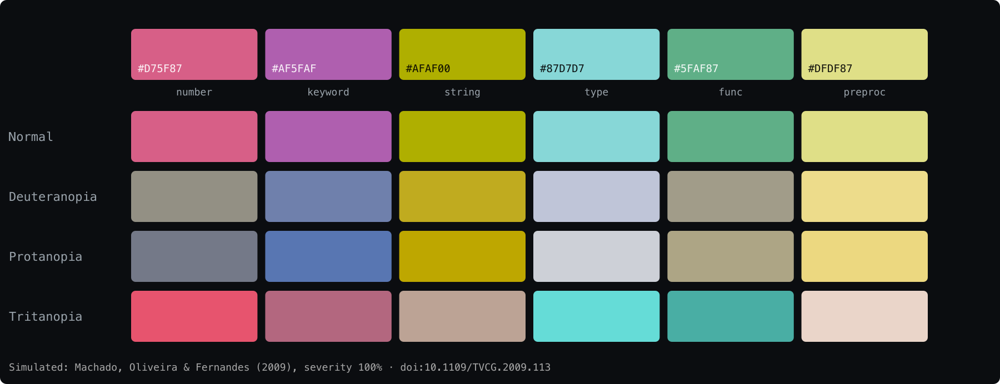

## Blinds (VS Code) — deuteranopia

Tan Ka-Shing ([marketplace](https://marketplace.visualstudio.com/items?itemName=tankashing.blinds-theme),
[repo](https://github.com/orbulant/blinds-theme), GPL-3.0). "A colorblind (deuteranopia) friendly,
dark, material designed theme." Syntax roles come from **Paul Tol's "bright" scheme**
(`#4477AA #EE6677 #228833 #CCBB44 #66CCEE #AA3377`). **Dark and light.**

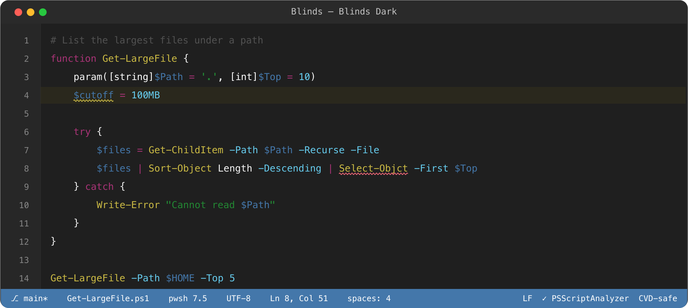

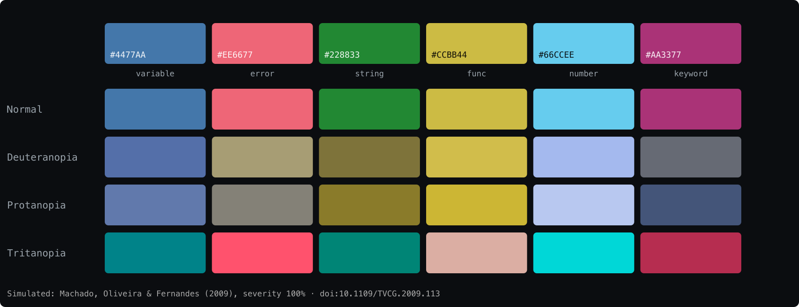

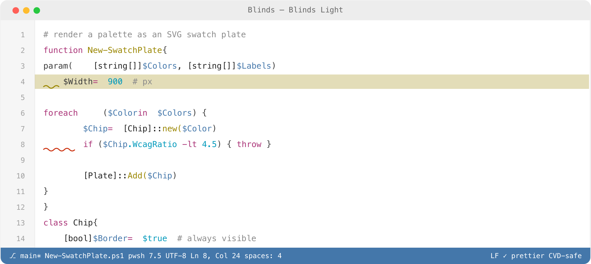

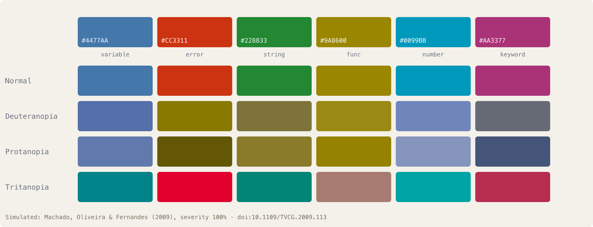

## Gentle Theme (VS Code) — teal + orange, WCAG AA

carlossalguero ([marketplace](https://marketplace.visualstudio.com/items?itemName=carlossalguero.gentle-theme), MIT).
Six variants (Light/Dark/Midnight × neutral/Warm). The source repo (`salgue441/gentle-theme`) is no
longer public (404 as of 2026-11-05); the palette below was extracted from the packaged VSIX.
Explicit rationale: "Red/green confusion → Teal + Orange palette (distinguishable by everyone)."

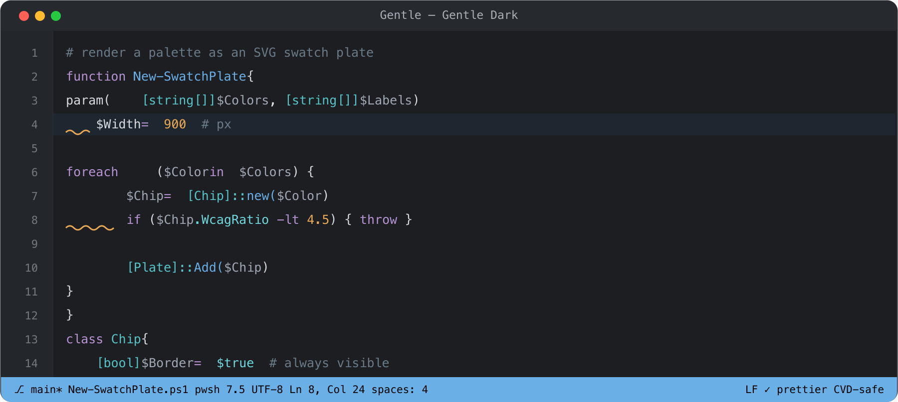

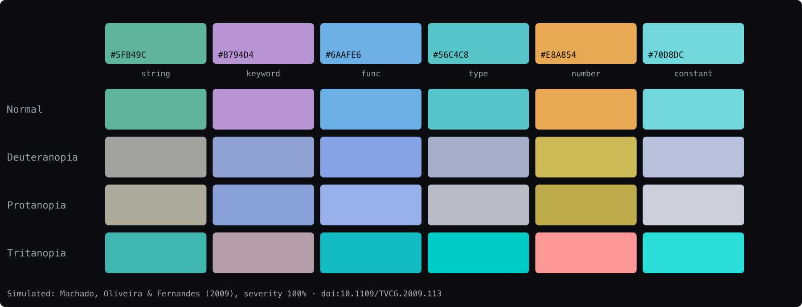

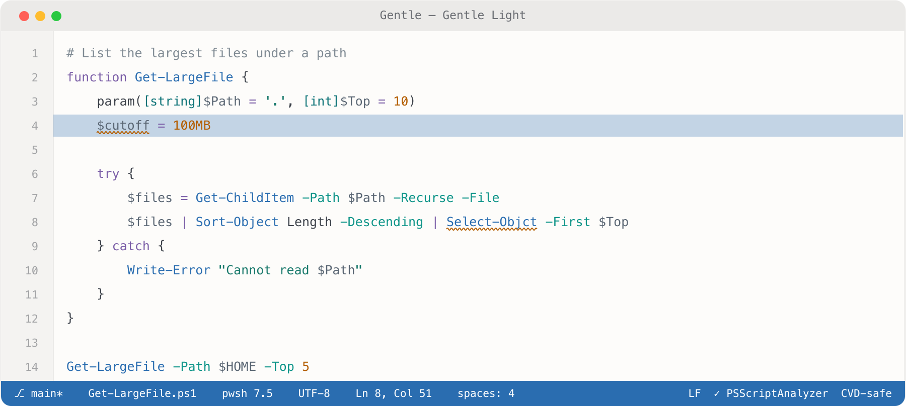

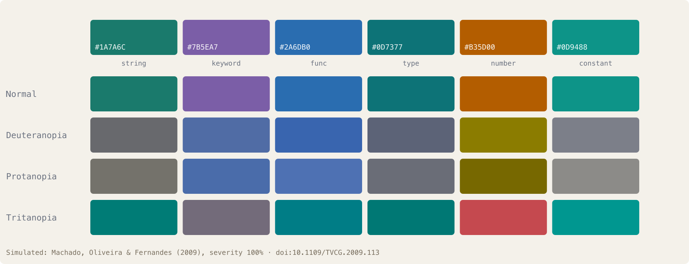

## Hakimi Deuteranopia Safe (Zed / VS Code / Obsidian)

hakimi ([Zed extension](https://zed.dev/extensions/hakimi-deuteranopia-theme),
[repo](https://github.com/zogwosh/hakimi-theme), MIT, 2026). Every color drawn from
deuteranopia-safe sets. **Dark and light.**

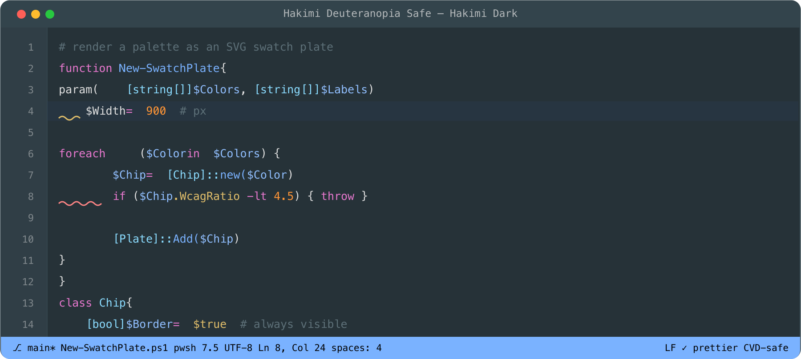

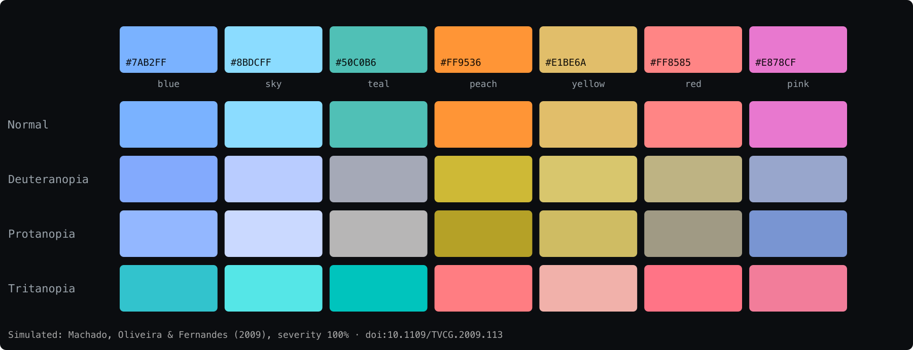

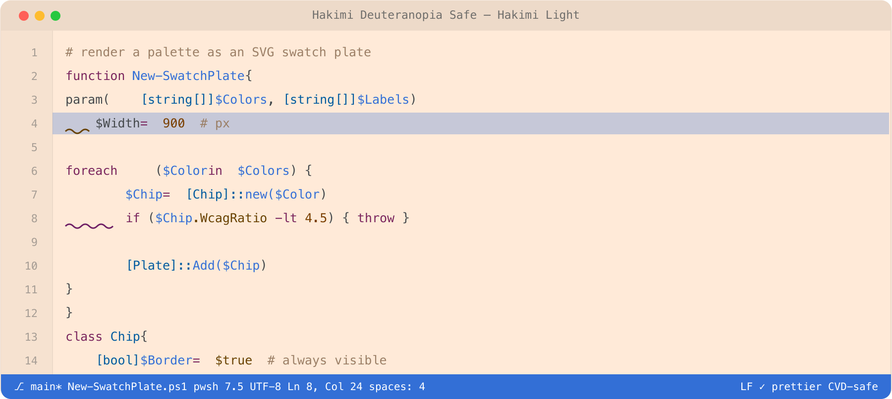

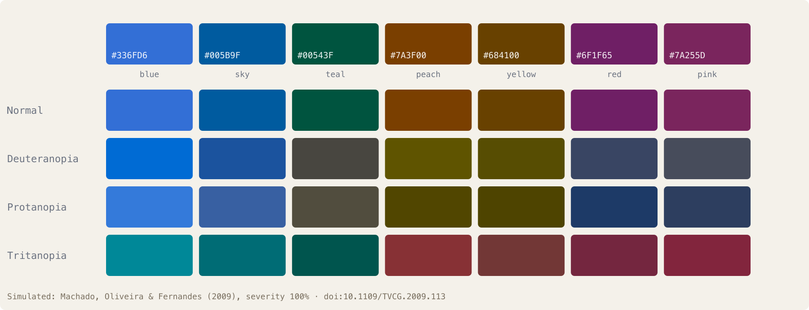

## Monokai Deuteranopia Colorblind (VS Code)

Felipe Zarco ([marketplace](https://marketplace.visualstudio.com/items?itemName=felipezarco.monokai-deuteranopia-colorblind),
[repo](https://github.com/felipezarco/monokai-deuteranopia-colorblind), MIT). Monokai retuned onto
the blue–yellow axis; reuses Okabe–Ito sky blue `#56B4E9` (caret) and reddish purple `#CC79A7` (types).
Dark only: bg `#0B1026`, fg `#D4E4FF`.

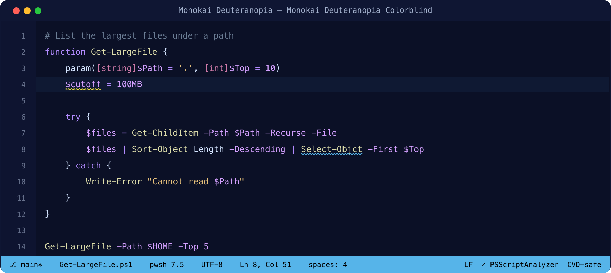

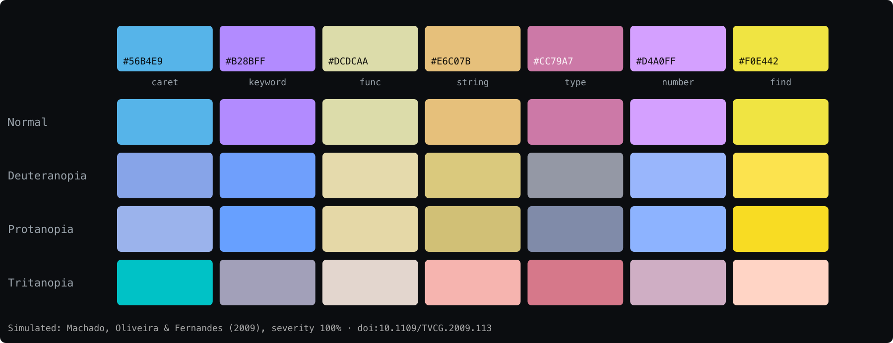

## More verified editor themes

| Theme | Platform | CVD target | Dark/Light | Link |
|---|---|---|---|---|
| **Color Blind Themes** (Goofygoobers) | VS Code | protanopia + deuteranopia (author has CVD) | dark | [repo](https://github.com/goofygoobers/color-blind-vscode-theme) · [marketplace](https://marketplace.visualstudio.com/items?itemName=Goofygoobers.color-blind-themes) |
| **Colorblind Theme** (Given Suman) | VS Code | all CVD types; generated from Tol's 23-color discrete rainbow | dark | [repo](https://github.com/givensuman/colorblind-theme) · [marketplace](https://marketplace.visualstudio.com/items?itemName=GivenSuman.colorblind-theme) |
| **One Dark Pro Colorblind** (Suhaybu) | VS Code | deuteranopia | dark (5 variants) | [repo](https://github.com/suhaybu/OneDarkPro-Colorblind) |
| **Github Dark Tritanopia** (zanaty) | VS Code | tritanopia | dark | [repo](https://github.com/moelzanaty3/github-dark-tritanopia) |
| **morimo** (ttak0422) | Neovim | general CVD; muted lightness-separated ramps | dark | [repo](https://github.com/ttak0422/morimo) |
| **vision.nvim** (shrik3, archived) | Neovim + Kitty/Alacritty | general CVD (author has CVD; tokyonight hues retuned) | dark | [repo](https://github.com/shrik3/vision.nvim) |
| **github-nvim-theme** (projekt0n) | Neovim | protan/deutan + tritanopia variants of GitHub themes | both | [repo](https://github.com/projekt0n/github-nvim-theme) |

## Helix — ships 8 CVD themes in its official runtime

[Helix](https://github.com/helix-editor/helix) (MPL-2.0) ships **eight
CVD themes out of the box** in `runtime/themes/` — four GitHub Primer ports (dark/light colorblind +
dark/light tritanopia, by OwOSwordsman) and four modus ports (operandi/vivendi ×
deuteranopia/tritanopia, by Matous Dzivjak from modus v4.6.0). The Primer token swap is faithful:
`scale.green.*` is aliased to the blue scale and red to orange. Listed on the official
[themes page](https://docs.helix-editor.com/themes.html). Along with Emacs and Neovim, Helix is one
of three editors shipping first-party CVD themes.

## JetBrains — three CVD plugins on the marketplace

Exactly three CVD plugins exist on the JetBrains marketplace
(`site:plugins.jetbrains.com colorblind` → 19011, 32346, 31376):

| Plugin | Author | CVD target | Notes | Link |
|---|---|---|---|---|
| **Colorblind Theme** | Captain Gopher / 4meepo | general (light only) | explicit intent, personal one-author theme, weak verification | [plugin](https://plugins.jetbrains.com/plugin/19011-colorblind-theme) · [repo](https://github.com/4meepo/jetbrain-colorblind-theme) |
| **GitHub Dark/Light Colorblind Islands** | 4iwen | protan/deutan | ports Primer colorblind tokens verbatim into the Islands UI; danger fg `#D47616` orange | [plugin](https://plugins.jetbrains.com/plugin/32346-github-dark-colorblind-islands) · [repo](https://github.com/4iwen/github-dark-colorblind-islands-theme) |
| **ColorSafe Themes** | Clément Séhan | protan+deutan and tritan (dark) | blue `#5BB8F5`/amber `#E6A020` and hot-pink `#FF216A`/cyan `#01D4F9` axes; per-color WCAG tables documented in the `.icls` source | [plugin](https://plugins.jetbrains.com/plugin/31376-colorsafe-themes) · [repo](https://github.com/clementsehan/color-safe-themes-jetbrains) |

## Atom, Xcode, Sublime — one entry each

- **Atom (archived):** thierryc's [dark-side-of-the-moon](https://github.com/thierryc/dark-side-of-the-moon-syntax)
  (dark, 2016) and [far-side-of-the-moon](https://github.com/thierryc/far-side-of-the-moon-syntax)
  (light, 2017) — MIT, Krzywinski-inspired palettes designed "to be accessible to as many people as
  possible… experiencing any kind of colorblindness." Design intent, not simulation-verified.
- **Xcode:** lebojo's [Vision (colorblind)](https://github.com/lebojo/colorblind-xcode-theme)
  (2026) — the first CVD Xcode theme family; dark (`#FC4D1F` vermilion keywords, `#21C0FC` cyan
  strings) + light + 16pt XL variants, both old `.xccolortheme` and new Xcode 16+ formats.
- **Sublime Text:** [InuProt](https://github.com/CudtMFrag/InuProt) (2026, MIT) — the only CVD
  Sublime theme (packagecontrol.io has zero CVD-labelled packages); dark + light, protan/deutan,
  keyword-green separated from orange control-flow by hue *and* bold weight, with checked-in
  VS Code ↔ Sublime converters.

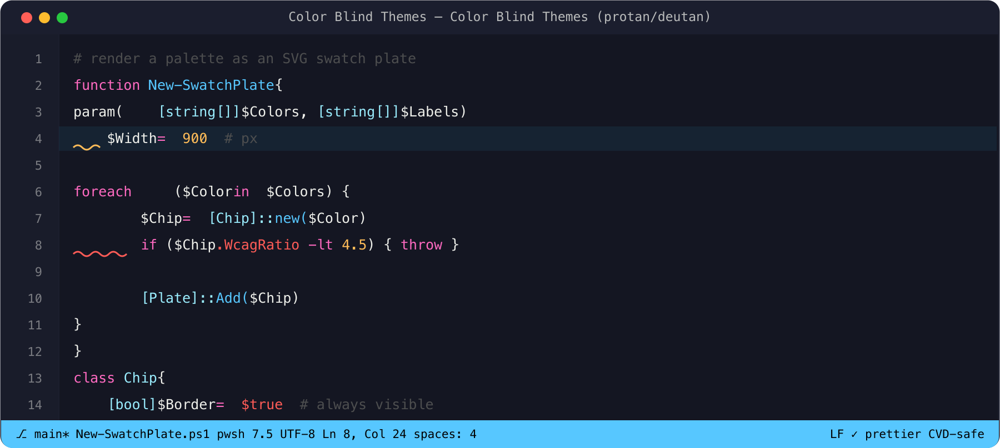

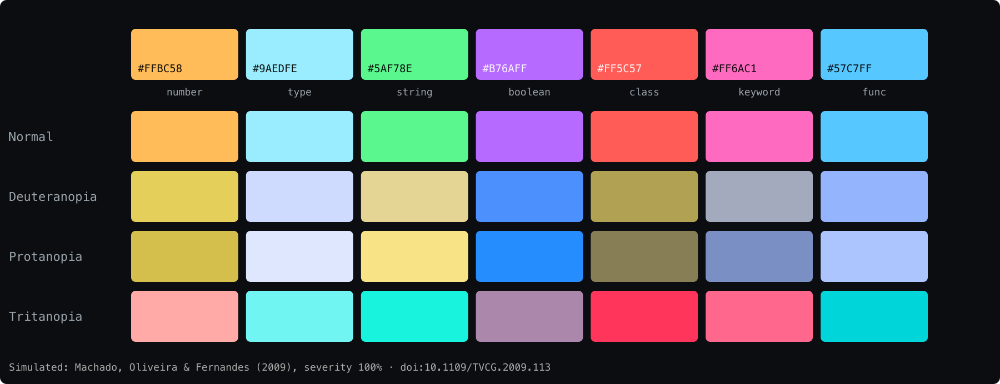

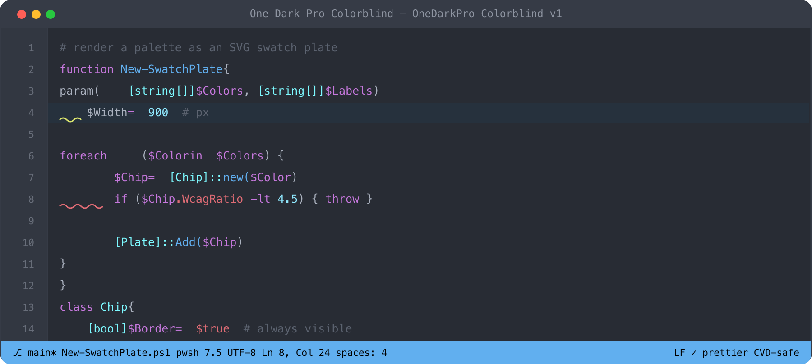

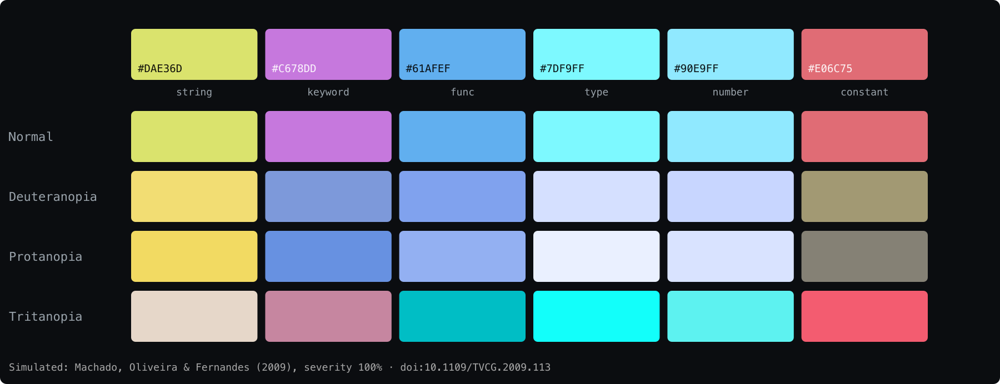

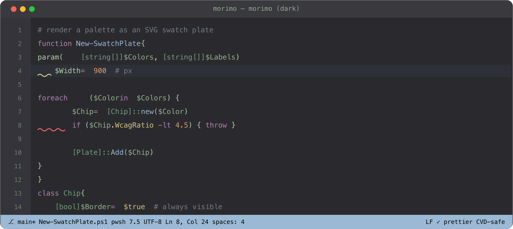

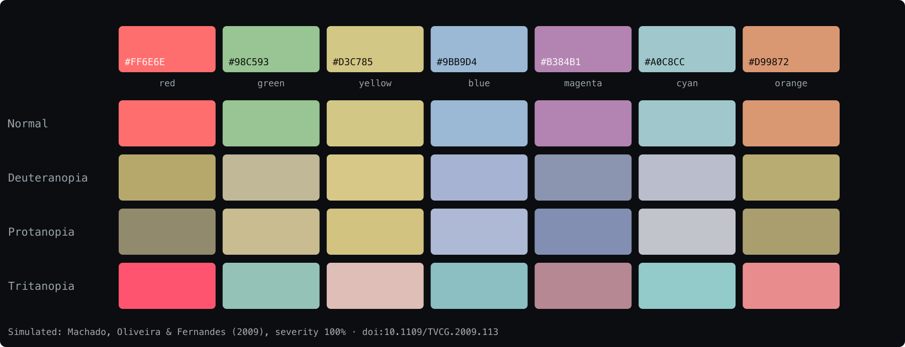

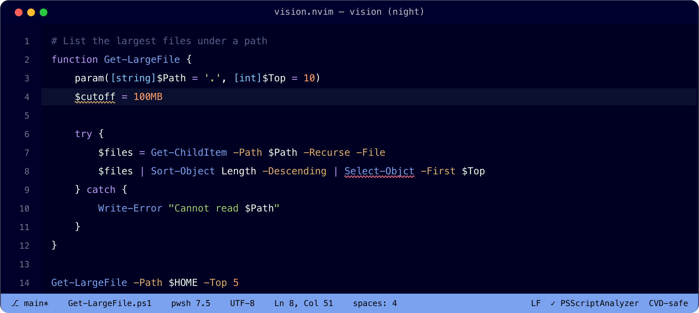

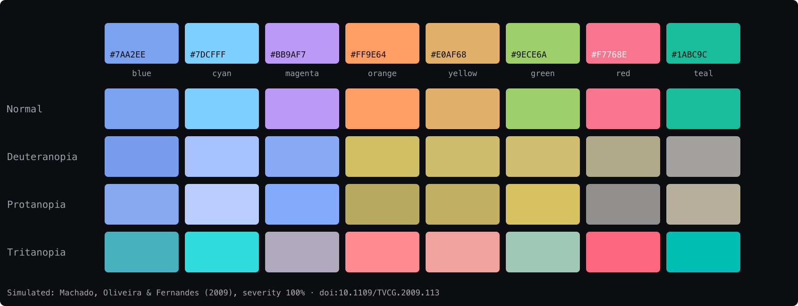

---
