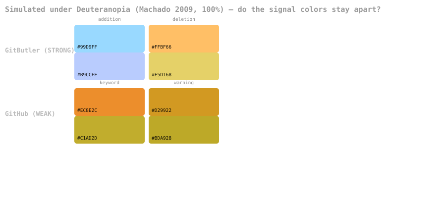
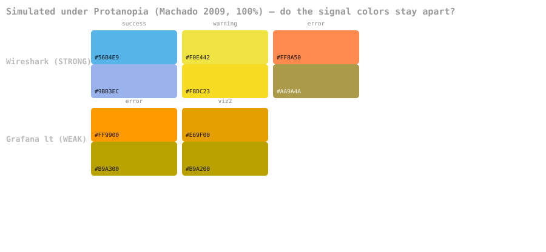
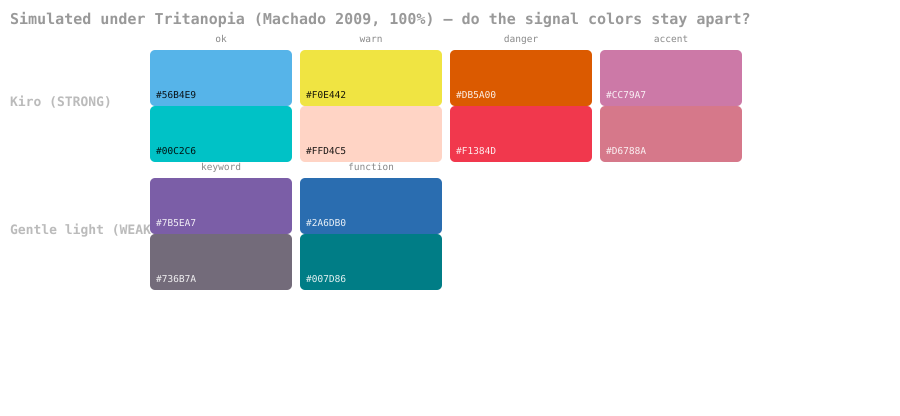

The catalog above records what themes claim. This section tests it.

## How the test works

For every catalogued theme we take its **signal colors** — the small set that carries meaning
(success/error/warning, diff add/delete, syntax roles) — and run two computations:

1. **Simulate** each color under each dichromacy (deuteranopia, protanopia, tritanopia) using the
   Machado, Oliveira & Fernandes (2009) physiologically-based model at 100% severity — the same
   model behind Coblis and most modern simulators. This produces what each color actually looks like
   to a viewer with that deficiency.
2. **Measure** the closest pair among those simulated colors using **CIEDE2000 (ΔE00)**, the standard
   perceptual color-distance metric. The minimum pairwise distance is the theme's worst case: the
   two signals most likely to be confused.

## How to read the numbers

ΔE00 is roughly: **~1** = a just-noticeable difference under ideal lab conditions; **<3** = two
colors most people will struggle to tell apart on a real screen; **>8** = clearly different at a
glance. A theme is only as strong as its weakest pair.

**Verdict scale** (a heuristic, not pass/fail):

- **STRONG** — closest pair ≥ 8 ΔE00 under all three dichromacies. Robust for any viewer.
- **ok** — closest pair ≥ 3. Usable, but the closest pair is a known tight spot.
- **WEAK** — closest pair < 3 under at least one deficiency. Some pair collapses on hue+lightness.

Reproduce every number below: `python3 scripts/verify_colorblind_themes.py` (stdlib only,
deterministic — it reads the same hex tables that generate the examples).

| Tier | Themes (mode) |
|---|---|
| **STRONG** (robust across all three) | Kiro (dark+light), Wireshark (dark+light), Cindervale (dark), Insomnia (dark), Blinds (dark), Opo (light) |
| **ok** (no pair fully collapses) | datum (both), Dalton (both), Dichromatic, Gentle (dark), Monokai Deuteranopia, Pitaya, Blinds (light), Opo (dark), Pierre (light), Lx Deep Sea, Color Blind Themes, ef-themes (light), One Dark Pro, Hakimi (dark), dracula-colorblind |
| **WEAK** (a pair collapses for ≥1 deficiency) | GitHub/Gemini (both modes), Grafana (both), coder (dark), modus-deuteranopia (both), Pierre (dark), vision.nvim, morimo, Gentle (light), ef-themes (dark), Hakimi (light), ColorSafe, Shroom Space |

**See the difference, don't just read it.** Each plate below shows a STRONG theme against a WEAK
theme under one simulated dichromacy — Normal row, then the CVD view. The WEAK pair's two chips
collapse to near-identical tones; the STRONG pair stays apart.

Under deuteranopia, GitHub's keyword `#ec8e2c` and warning `#d29922` become `#C1AD2D` and `#BDA928`
— 7.5 RGB units apart, effectively one color. GitButler's addition `#99d9ff` and deletion `#ffbf66`
stay 156 units apart.

**Read this table honestly — three caveats:**

1. **A WEAK verdict is not "broken."** Most of these themes deliberately add a *luminance* gap
   between hues that share an axis (GitHub's keyword orange `#ec8e2c` vs. warning amber `#d29922`
   collapse to ΔE≈1.1 in *hue* under deuteranopia, but they're never used as a binary good/bad
   signal). The metric measures hue+lightness collapse; it does not model font weight, icons, or
   the redundant text cues these UIs also provide.
2. **Single-deficiency themes collapse by design under the others.** modus-deuteranopia scoring WEAK
   under deuteranopia looks alarming until you see the weakest pair is red `#ff5f59` vs green
   `#44bc44` — two colors the deuteranopia variant *deliberately stops using as a semantic pair*
   (errors route to a different channel). Judge a theme against the deficiency it targets.
3. **The strongest independent signal is the engineering gate, not the hue choice.** Every STRONG
   entry (Kiro, Wireshark, Cindervale, Opo, Blinds) ships a *test that measures exactly this* and
   fails the build on regression — which is why they top the table. Themes that only *assert* CVD
   safety cluster at the bottom.

The full per-theme numbers (all three deficiencies, weakest pair identified) are the script's
stdout and are reproducible.

**The one-line takeaway:** the themes that *measure* survive; the themes that *claim* often don't.
If you're choosing a theme for a CVD user, prefer one with a simulation/contrast build gate.

## App/platform-level themes verify far better than editor themes

Running the same metric over the app-level signal palettes (the small good/bad/status sets each
product shows) gives a markedly different picture: **11 STRONG, 3 ok, 5 WEAK** — versus the
editor/terminal tier's 8/17/17. Apps only need to separate 2–4 status colors, so they can space
them far apart; editors must cram 6–8 syntax roles into one palette.

| Tier | App-level themes |
|---|---|
| **STRONG** | GitButler (dark ΔE≈45, light ΔE≈61 — near-perfect), Cura, SimpleCov (dark), plannotator (dark), iamb, OpenFront.io, Jenkins Wall Display, deepinv, narmi, Insomnia, Wireshark-tritan |
| **ok** | Talishar deuteranopia + protanopia palettes, Moira |
| **WEAK** | Gitea (both), SimpleCov (light), plannotator (light), Talishar *tritanopia* palette |

Two findings worth naming:

- **Per-deficiency palettes confirmed empirically.** Talishar ships one palette per dichromacy, and
  the numbers show exactly why that's the right call: each palette is strong under its *target*
  deficiency (deutan palette ΔE 17.3 under deuteranopia; protan ΔE 20.2 under protanopia) but
  collapses under the others (tritan palette: 2.6 under deuteranopia). Per-deficiency variants beat
  one "universal" palette — matching what Grafana (4 themes) and modus/ef do.
- **The GitHub orange/amber weakness propagates downstream.** Gitea and SimpleCov inherit GitHub's
  colorblind pair (`#f0883e` orange vs `#d29922`/`#9a6700` amber), and both score WEAK for the same
  reason the flagship does. SimpleCov's *dark* mode dodges it (its missed-orange is far from its
  skipped-yellow); its *light* mode doesn't. When you port a palette, re-measure it.

**GitButler is the strongest CVD palette in this entire report** — its diff addition/deletion text
pair (`#99d9ff`/`#ffbf66` dark, `#0d59bf`/`#bf590d` light) sits ΔE 42–61 apart under every
dichromacy, roughly 5× the "clearly different" threshold. That's what designing the two-color case
from scratch, rather than remapping an existing 8-color palette, buys you.

---
